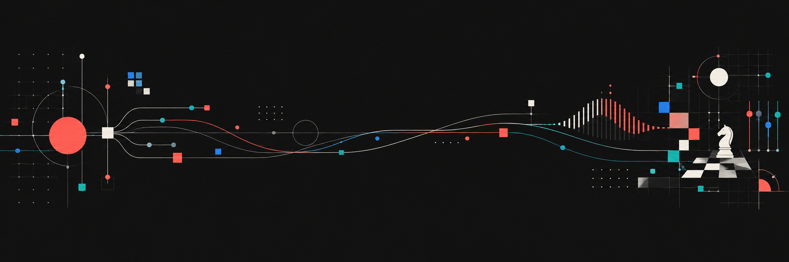

  

# Peter Y.Z. Bruun

Building practical systems for AI-assisted productivity, digital workflows, automation, and music production.

## About me

- I explore reusable AI skills, agent workflows, and practical automation.
- I build personal knowledge systems with Markdown, Obsidian, and local-first tools.
- My creative interests include digital design, chess, and music production.
- I am based in Copenhagen, Denmark.

## Chess.com

  
  
  
  

The live badges read public ratings from Chess.com's Published-Data API. [See the badge guide](CHESSCOM_BADGES.md) for copy-ready variants, Daily and puzzle peak badges, and troubleshooting.

## Public work

### [AI Skills Portfolio](https://github.com/peteryzbruun/pyzb-agent-skills-portfolio)

A growing portfolio of reusable AI skills and workflows.

## Tools and platforms

### Knowledge systems

  
  

### AI workflows

  
  

### Design and productivity

  
  

## Current interests

`AI agents` · `knowledge systems` · `automation` · `digital design` · `chess` · `music production`

## Elsewhere

- [peteryzbruun.online](https://peteryzbruun.online)
- [All public repositories](https://github.com/peteryzbruun?tab=repositories)

